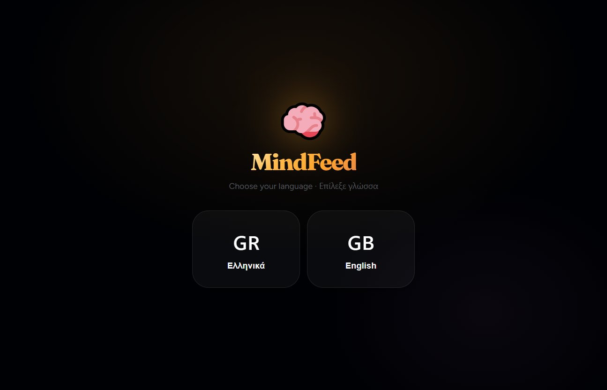

# MindFeed

A knowledge PWA without infinite scroll: ten verified cards a day, no likes, no engagement tricks.

[Live app](https://mindfeed-tpainn.vercel.app)


## What is MindFeed?

Most apps compete for your attention. MindFeed competes for your growth.

Every morning you get **10 knowledge cards** - science, psychology, philosophy, nature, history, and more - each backed by a real source with a DOI or citation. When you've read them, that's it for the day. **No infinite scroll. Ever.**

| Feature | Description |
|---------|-------------|
| 🎯 **10 cards/day hard limit** | No infinite scroll, by design |
| 📚 **Verified sources** | Every card has a real DOI, book, or paper |
| 🧬 **18 knowledge categories** | Science, psychology, nature, philosophy, and more |
| 🇬🇷 / 🇬🇧 **Bilingual** | Greek-first, full English support |
| 🔖 **Bookmarks** | Save cards to revisit later |
| 🤖 **AI simplification** | PubMed papers → readable cards via Claude |
| 📱 **PWA** | Install like a native app on iOS/Android |
| 🌙 **Low Cortisol UX** | No likes, no share counts, no streak pressure |

---

## Architecture

```
mindfeed/
├── backend/                    # Node.js + Express API
│   ├── models/
│   │   ├── Category.js         # 18 knowledge categories
│   │   ├── Card.js             # Core content unit (with media fields)
│   │   ├── User.js             # Auth, preferences, streak, bookmarks
│   │   └── DailyFeed.js        # Daily 10-card feed (idempotent)
│   ├── routes/
│   │   ├── cards.js            # GET /api/cards, GET /api/cards/:id
│   │   ├── feed.js             # GET /api/feed/today
│   │   ├── users.js            # Auth, bookmarks, preferences
│   │   └── admin.js            # Draft management, pipeline trigger
│   ├── services/
│   │   ├── feedGenerator.js    # Personalized feed algorithm
│   │   └── claudePipeline.js   # PubMed → Gemini (free tier) → Greek card
│   ├── scripts/
│   │   ├── weeklyPipeline.js   # Fetch new PMIDs → AI drafts
│   │   └── expandSeed.js       # Bulk seed 40 verified cards
│   ├── middleware/
│   │   ├── auth.js             # JWT authentication
│   │   └── adminAuth.js        # Bearer token admin protection
│   └── seed.js                 # 10 verified starter cards
│
└── frontend/                   # React 19 + Vite PWA
    └── src/
        ├── components/
        │   ├── Card.jsx         # Swipeable knowledge card
        │   ├── Feed.jsx         # Daily 10-card feed container
        │   ├── LangPicker.jsx   # First-launch language selection
        │   ├── BookmarksScreen.jsx
        │   └── AuthForm.jsx
        ├── context/
        │   ├── AuthContext.jsx  # JWT auth state
        │   └── LangContext.jsx  # i18n language state
        ├── i18n/
        │   ├── el.json          # Greek strings
        │   ├── en.json          # English strings
        │   └── useT.js          # Custom translation hook
        ├── motion/
        │   └── variants.js      # Framer Motion shared variants
        └── api/
            └── client.js        # Fetch wrapper
```

---

## Tech Stack

| Layer | Technology |
|-------|-----------|
| **Frontend** | React 19, Vite 8, Framer Motion, PWA |
| **Backend** | Node.js, Express |
| **Database** | MongoDB + Mongoose |
| **AI Layer** | Claude Sonnet 4.6 (Anthropic) |
| **Auth** | JWT + bcryptjs |
| **Hosting** | Render (free tier) |
| **Content APIs** | PubMed, arXiv, NASA, OpenLibrary, Wikipedia |

---

## Getting Started

### Prerequisites

- Node.js 18+
- MongoDB URI (local or [MongoDB Atlas](https://mongodb.com/atlas) free tier)
- Anthropic API key (for the AI pipeline)

### 1. Clone & Install

```bash
git clone https://github.com/TPAINN/mindfeed.git
cd mindfeed

# Install backend deps
cd backend && npm install

# Install frontend deps
cd ../frontend && npm install
```

### 2. Environment Variables

**`backend/.env`**
```env
MONGO_URI=mongodb+srv://...
JWT_SECRET=your_jwt_secret_here
GEMINI_API_KEY=...   # free AI Studio key (aistudio.google.com), no billing
ADMIN_PASSWORD=your_admin_password
PORT=5000
```

**`frontend/.env`**
```env
VITE_API_URL=http://localhost:5000
```

### 3. Seed the Database

```bash
cd backend

# Seed 10 starter cards + 18 categories
node seed.js

# Add 40 more verified cards across all categories
node scripts/expandSeed.js
```

### 4. Run

```bash
# Terminal 1 - backend
cd backend && npm run dev

# Terminal 2 - frontend
cd frontend && npm run dev
```

Open [http://localhost:5173](http://localhost:5173)

---

## AI Content Pipeline

MindFeed uses Claude Sonnet 4.6 to convert PubMed research papers into readable Greek knowledge cards.

```
PubMed Abstract (EN, scientific)
        ↓
Claude Sonnet 4.6
        ↓
{
  title: "Ελκυστικός τίτλος",
  body: "3-4 απλές προτάσεις",
  tldr: "Με λίγα λόγια...",
  whyItMatters: "Γιατί σε αφορά;"
}
        ↓
Draft card → Admin review → Published
```

### Weekly Pipeline

Update `TARGETS` in `backend/scripts/weeklyPipeline.js` with fresh PMIDs:

```bash
MONGO_URI=... GEMINI_API_KEY=... node scripts/weeklyPipeline.js
```

### Admin API

Manage drafts with Bearer token auth:

```bash
# List drafts
GET /api/admin/drafts
Authorization: Bearer $ADMIN_PASSWORD

# Publish a draft
PATCH /api/admin/cards/:id
{ "status": "published" }

# Trigger pipeline remotely
POST /api/admin/run-pipeline
{ "targets": [{ "pmid": "12345678", "categorySlug": "psychology" }] }
```

---

## Card Schema

Every card must have a real, verifiable source:

```js
{
  title,          // max 120 chars
  body,           // max 800 chars - the knowledge
  tldr,           // max 160 chars - "Με λίγα λόγια"
  whyItMatters,   // max 300 chars - practical relevance

  category,       // ref → 18 categories
  tags,           // search keywords
  mood,           // inspiring | surprising | calming | motivating | mind-blowing | practical

  source: {
    type,         // paper | book | documentary | website | pubmed | arxiv | nasa
    title,
    author,
    year,
    url,
    doi,          // required for papers
  },

  difficulty,     // easy | medium | advanced
  language,       // el | en
  status,         // draft | published | archived
  imageUrl,       // optional cover image
  verified,       // manually verified flag
}
```

---

## Deployment (Render)

1. **Backend:** New Web Service → `backend/` → Start: `node server.js`
2. **Frontend:** New Static Site → `frontend/` → Build: `npm run build` → Publish: `dist/`
3. Set all env vars in Render dashboard
4. Frontend: set `VITE_API_URL` to your backend Render URL

---

## Roadmap

- [x] V1 - Auth, Feed, Card, Claude pipeline, PWA
- [x] V2 - Framer Motion animations, i18n (EL/EN), Bookmarks, Admin panel
- [ ] V3 - Rich media cards (video + photos), 500+ cards, multi-API auto-discovery
- [ ] V4 - Offline mode, push notifications, knowledge streaks

---

## Acknowledgements

- Research sourced from [PubMed](https://pubmed.ncbi.nlm.nih.gov/), [arXiv](https://arxiv.org/), [NASA](https://api.nasa.gov/), and open academic publishers
- Built with ❤️ in Greece 🇬🇷

---

<div align="center">

Made by **Apostolos** · Greece 🇬🇷

*Knowledge is the only asset that compounds without risk.*

</div>
